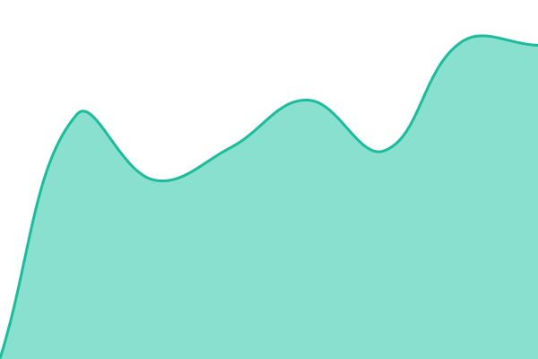
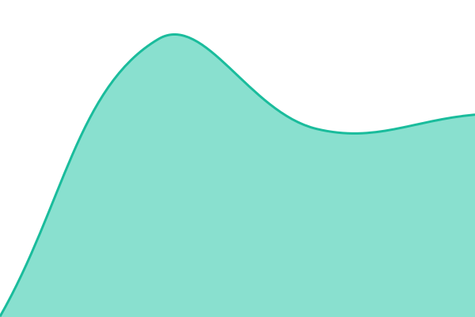

# Statut de Prowess

Sondes externes de Prowess, avec [Upptime](https://github.com/upptime/upptime) : toutes les 5 minutes depuis GitHub Actions, hors de l'hébergement Scaleway. Une panne ouvre une issue, fermée au retour du service.

<!--live status--> **🟩 All systems operational**

<!--start: status pages-->
<!-- This summary is generated by Upptime (https://github.com/upptime/upptime) -->
<!-- Do not edit this manually, your changes will be overwritten -->
<!-- prettier-ignore -->
| URL | Status | History | Response Time | Uptime |
| --- | ------ | ------- | ------------- | ------ |
|  [App](https://app.getprowess.fr/api/health/live) | 🟩 Up | [app.yml](https://github.com/Prowess-org/status/commits/HEAD/history/app.yml) | 

 478ms
     
 | 

<a href="https://Prowess-org.github.io/status/history/app">100.00%</a>
    

|  Console | 🟩 Up | [console.yml](https://github.com/Prowess-org/status/commits/HEAD/history/console.yml) | 

 557ms
     
 | 

<a href="https://Prowess-org.github.io/status/history/console">100.00%</a>
    

|  [Démo](https://demo.getprowess.fr/api/health/live) | 🟩 Up | [demo.yml](https://github.com/Prowess-org/status/commits/HEAD/history/demo.yml) | 

 462ms
     
 | 

<a href="https://Prowess-org.github.io/status/history/demo">100.00%</a>
    

<!--end: status pages-->

## Fonctionnement

- `Uptime CI` sonde les adresses de `.upptimerc.yml` ; `Response Time CI`, `Summary CI` et `Graphs CI` tiennent l'historique et ce résumé.
- Jeton intégré de GitHub Actions seulement, permissions déclarées dans chaque workflow, actions figées par SHA.
- Pas de mise à jour automatique du modèle Upptime (workflows `update-template` et `updates` retirés) : une nouvelle version se reporte à la main, SHA compris.
- Pas de page de statut publique pour l'instant.
